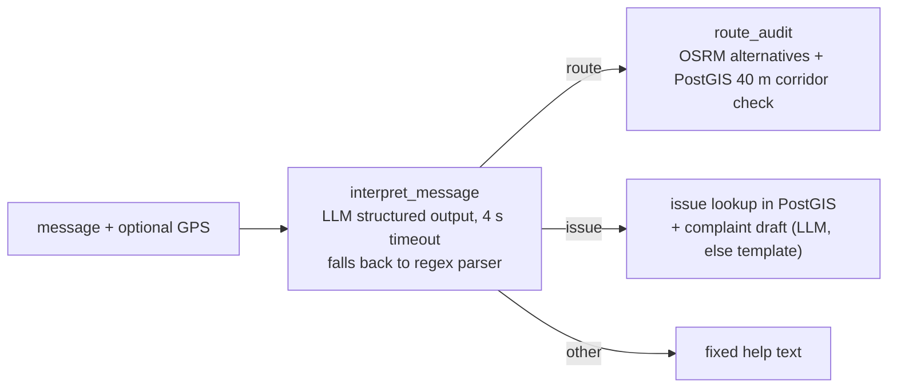
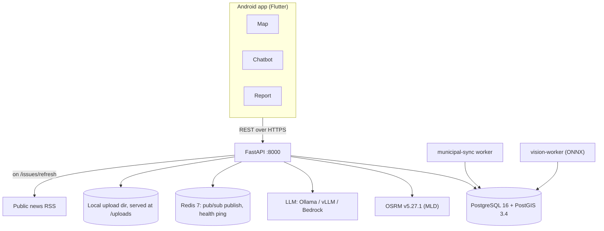

# RCMCA — Agentic Road-Condition Assistant for Android

Road Condition Monitoring, Intelligence & Navigation for **Hyderabad**. Citizens report road hazards from an Android app, see them on a map, and ask an AI assistant for a hazard-aware route or a draft complaint to the ward authority.

**MVP v1** · Flutter Android app (`RCMCA Road Watch`) + FastAPI / LangGraph / PostGIS / OSRM backend.

> **Read this before you install or demo it**
>
> - **Demo data.** Seeded hazards, ward boundaries and authority contacts are synthetic. Every authority email is a plus-address on one demo mailbox, so **"Send via Mail App" does not reach a real municipal officer.** See [Data provenance](#data-provenance).
> - **No hosted backend, no authentication.** You self-host the API and build the APK against your own HTTPS URL. Anyone who can reach the API can write to it.
> - **Sideload only.** The release build is signed with the Android *debug* key. It is not a Google Play artifact.

---

## Release at a glance

| | |
|---|---|
| Release | MVP v1 |
| App | `RCMCA Road Watch` · application ID `org.rcmca.roadwatch` · version `0.1.0+1` |
| Platform | Android (Flutter). An iOS project exists in `mobile/ios` but has not been built or validated |
| Distribution | Sideloaded APK (debug-signed release build). No prebuilt APK is published from this repo; build it [from source](#3-build-the-mvp-v1-release-apk) |
| Backend | Self-hosted Docker Compose stack. AWS Terraform exists in `infra/aws` but has **not** been applied |
| Coverage | Hyderabad only (routing graph, locality gazetteer, ward table) |
| Needs | Internet (map tiles and API). No offline mode |

---

## What the app does

Three bottom-navigation tabs.

### Map
- MapLibre map centred on Hyderabad (OpenFreeMap "liberty" style). Hazards for the visible viewport come from `GET /api/v1/issues`.
- Pins are coloured by status (see [status colours](#status-colours)). Tap a pin for details: category, severity, confidence, report count, photos, ward and authority, description, and the source article link for news-derived items.
- Long-press the map to drop a pin and file a quick report at that spot (category, severity, impact, description; no photos).
- **Route planner:** type *From* and *To* place names (default `Gachibowli` → `Tarnaka`; `my location` works for *From*). The recommended route is drawn in cyan; hazards within 40 m of it are ringed and counted in a banner.
- **Driveway mode:** a position-follow view — 45° tilt, a heading arrow, a camera that follows live GPS, an ongoing-notification foreground service, and a "CAUTION: … reported within 50m!" banner when any loaded hazard is within 50 m of the phone. It is **not** turn-by-turn navigation (see [limitations](#known-limitations)).
- **50 m verification prompt:** while a route is active, each hazard reload checks the last GPS fix; a loaded hazard within 50 m opens the verification survey, once per issue per app session.
- App-bar refresh calls `POST /api/v1/issues/refresh` (tooltip "Scrape news & reload hazards"; the API ensures the demo issues exist, then imports public news RSS leads).

### Chatbot
Free-text assistant backed by `POST /api/v1/chat` (see [How the agent works](#how-the-agent-works)).
- *"Plan a safer route to Charminar"* → a route comparison with a plain-language explanation and a **Start In-App Driveway** button that hands the route to the Map tab.
- *"Any potholes near Madhapur?"* / an issue UUID → the matching issue card plus a drafted complaint email.
- **Send via Mail App** opens the phone's mail composer through a `mailto:` link. The app never sends anything itself; the user reviews and sends.

### Report
A four-step survey for a new hazard:
1. Ten yes/no site checks (at least 6 "Yes" are required for a *new* report).
2. Ten 1–5 condition ratings; the rounded mean becomes the severity.
3. Ten multiple-choice impact questions; the first answer sets the category.
4. Evidence: up to 4 photos from the in-app camera, an auto-locked GPS pin with its accuracy, and a description of at least 8 characters.

The same survey, without the evidence step, is used to **verify** an existing issue ("still there" vs "fixed"). Each device has an anonymous UUID (`SharedPreferences`) used as its voter ID.

---

## How the agent works

`POST /api/v1/chat` runs a small LangGraph state machine (`build_chat_graph` in `rcmc_graph.py`):



What "agentic" means here, precisely:

- **The LLM does two jobs only:** classify the request into `route` / `issue` / `other` (extracting origin, destination, issue ID or search phrase, and language), and draft the complaint email.
- **Everything that produces facts is deterministic code:** place resolution, OSRM routing, hazard-on-route queries, route ranking, issue search, confidence and status updates.
- **Bounded and stateless:** one pass through the graph per request. No tool-calling loop, no conversation memory (the request carries only the message and optional coordinates), no side effects. A draft is returned to the user; nothing is filed or sent.
- **Works without a model.** If the LLM is down or slow, chat falls back to a regex intent parser (English plus Telugu/Hindi route phrasing) and a template email in `en` / `te` / `hi`. The `/issues/assess` graph has no such fallback and returns `503`.
- **Model backends:** any OpenAI-compatible server (default Ollama `qwen2.5:3b` at `host.docker.internal:11434/v1`; an optional vLLM profile serves `Qwen2.5-3B-Instruct-AWQ`) or AWS Bedrock (`LLM_PROVIDER=bedrock`, default `qwen.qwen3-32b-v1:0`).

A second graph, `POST /api/v1/issues/assess`, normalises free text into structured facts, computes a rule-based priority score and dispatch tier, and drafts a complaint in `en` / `te` / `hi`. It is available through the API but is **not called by the app**.

---

## Architecture



| Compose service | Role | Host port |
|---|---|---|
| `api` | FastAPI app; applies the SQL migrations in `db/migrations` and the idempotent demo seed on startup (the base schema comes from `db/init`, which Postgres runs on an empty volume) | `8001` |
| `postgis` | `postgis/postgis:16-3.4` | `5433` |
| `redis` | Publishes `road_issues` events (`issue_reported`, `issue_verified`). There is no WebSocket or subscriber yet | `6380` |
| `osrm` | Routing on `osrm-data/hyderabad.osrm` | `5001` |
| `municipal-sync` | Polls an authorised CSV/JSON export every 30 min. **Idle unless `GHMC_FEED_URL` / `PRAJAVANI_FEED_URL` is set** | — |
| `vision-worker` | Claims queued image jobs (`FOR UPDATE SKIP LOCKED`) and runs ONNX detection | — |
| `vllm` (profile `inference`) | Optional local GPU LLM server | `8002` |

---

## Backend API

Interactive docs at `http://localhost:8001/docs` once the stack is running. There is **no authentication**.

| Method | Path | Purpose | Used by app |
|---|---|---|:-:|
| GET | `/health` | PostGIS + Redis readiness | |
| GET | `/api/v1/issues?south&west&north&east&limit` | Non-resolved issues in a viewport (default 500, max 1000) | ✓ |
| POST | `/api/v1/issues/report` | Create an issue, or merge into the nearest same-category active issue within 25 m | ✓ |
| GET | `/api/v1/issues/{id}` | One issue with its evidence gallery | |
| POST | `/api/v1/issues/{id}/verify` · `/api/v1/issues/verify` | One vote per user per issue; recalculates confidence, severity, status | ✓ |
| POST | `/api/v1/issues/refresh` | Ensure demo issues exist, then import public news RSS leads | ✓ |
| POST | `/api/v1/issues/assess` | Report-triage LangGraph (facts, priority, complaint draft) | |
| POST | `/api/v1/issues/{id}/vision` · GET `…/vision/{assessment_id}` | Queue an image for ONNX detection / poll the result | |
| POST | `/api/v1/routes/plan` | OSRM alternatives + hazard audit. `origin`/`destination` accept a place name, `[lon, lat]`, or `{latitude, longitude}` | ✓ |
| POST | `/api/v1/chat` | Chat graph (route / issue / other) | ✓ |
| POST | `/api/v1/uploads/local` | Store up to 4 JPEG/PNG/WebP images (≤ 8 MB each, magic bytes checked) on the API's disk | ✓ |
| POST | `/api/v1/uploads/presign` | 5-minute S3 PUT URL; `503` unless `S3_BUCKET` and `S3_PUBLIC_BASE_URL` are set | |

Example bodies:

```jsonc
// POST /api/v1/issues/report
{ "category": "pothole", "description": "A deep pothole is forcing bikes into traffic.",
  "latitude": 17.4362, "longitude": 78.4483, "severity": 4 }

// POST /api/v1/routes/plan
{ "origin": "Gachibowli", "destination": "Tarnaka" }

// POST /api/v1/chat
{ "message": "Plan a safer route to Charminar", "user_lat": 17.4400, "user_lon": 78.3480 }

// POST /api/v1/issues/{id}/verify
{ "user_id": "6e6b4e3b-5a0e-45d3-b5ea-82e625e87f57", "still_present": true,
  "condition_score": 4, "impact_mcq": "Pothole / Crater" }
```

`/chat` route replies also contain `deep_link: rcmcs://navigate?route_id=…`; the app does not register that scheme.

### Rules as implemented

- **Deduplication:** same category, not resolved, within **25 m** (PostGIS geography), serialised with an advisory lock. A merge increments `report_count`, takes the higher severity, and merges image URLs (max 12).
- **Confidence:** base `2.5` for `ghmc_portal` issues, else `1.0`; each `CONFIRM`/"still present" vote `+0.5`, each `RESOLVED`/"fixed" vote `−0.75`. Confidence `≤ 0` → `resolved`; `ghmc_portal` → `verified_ghmc`; `> 1.0` → `active_hazard`; otherwise unchanged. A repeat vote by the same user replaces their earlier one.
- **Severity after votes:** mean `condition_score` of voters who still see the hazard, rounded to 1–5.
- **Route corridor:** hazards that are not resolved and lie within **40 m** of a route line.
- **Route recommendation:** OSRM is asked for up to 3 alternatives. The recommended route is the one with no ORANGE/RED hazards if any exists, then fewest RED, fewest ORANGE, fewest total, shortest duration, shortest distance. If OSRM is unreachable the API returns clearly labelled *approximate* corridors (`routing_source: "fallback_geometry"`) that are not road-snapped.
- **Place resolution:** built-in gazetteer of 108 Hyderabad localities → ward table → Nominatim (public instance unless `GEOCODER_BASE_URL` is set) with `, Hyderabad, Telangana, India` appended to the query. The request carries no bounding-box or country filter. It has a 4 s deadline, results are cached in `geocode_cache`, and uncached requests are spaced ≥ 1.1 s apart.

### Status colours

Computed by a database trigger (`rcmc_status_color`) and shown in the app:

| Colour | App label | Rule |
|---|---|---|
| BLUE | Resolved | status `resolved` |
| RED | Ecosystem/Environment | impact or description mentions ecosystem, sewage, sewer or nala |
| ORANGE | Impacting Others | severity ≥ 4 or report count ≥ 3 |
| YELLOW | Still Active | status `active_hazard` or `verified_ghmc` |
| GREEN | Registered | everything else |

`GET /api/v1/issues` excludes resolved issues, so blue pins do not appear on the map in practice.

---

## Data provenance

| Data | What it really is |
|---|---|
| Seeded issues | A fresh database holds **118 synthetic rows**: 6 from `db/init/002_seed_demo.sql`, 12 `field_survey` records with simulated votes, and 100 `demo_seed` records (20 roads × 5 conditions, 20 of them already `resolved`). They are illustrative, not official complaints |
| Ward table | 14 wards drawn as ~1.2 km squares around locality centres, with demo ward numbers. **Not** official GHMC / Cyberabad / Malkajgiri boundaries |
| Authority emails | Every ward address is a Gmail-style plus-address (`name+ward-tag@…`) on one mailbox set by `DEMO_BASE_EMAIL` (default in `backend/app/migrations.py`). Replace before any real use |
| News issues | `POST /issues/refresh` imports matching items from The Hindu (Hyderabad) and Siasat RSS feeds; two Google News search feeds are queried only if those yield nothing, and `HYD_CIVIC_RSS_URLS` overrides the list. Each is a *news lead*: status `community_pending`, placed at the centroid of a named locality, with the article link kept. Items with no recognised locality are skipped |
| Municipal feeds | Not connected. GHMC's citizen flow needs a grievance ID and OTP, so a bulk sync needs an official export/API |
| Road network | Geofabrik Southern Zone extract of OpenStreetMap (ODbL), clipped to `78.15,17.15,78.72,17.62` |
| Vision model | Optional pothole-only YOLOv8 ONNX starter (`peterhdd/pothole-detection-yolov8`). Not in the repo, not validated on Hyderabad roads. The ONNX metadata says AGPL-3.0 while the model card says Apache-2.0 |

---

## Build and run

### 1. Backend (Docker Compose)

Requirements: Docker with Compose, Python 3 (download helper), PowerShell for the helper scripts, and an OpenAI-compatible chat endpoint if you want LLM output.

```powershell
Copy-Item .env.example .env              # local-dev defaults only
python scripts/download_osm.py           # Geofabrik Southern Zone extract (large download)
.\scripts\prepare_osrm_data.ps1          # clip to Hyderabad and build the OSRM MLD graph
docker compose up --build
```

- Open `http://localhost:8001/docs`. Check readiness at `http://localhost:8001/health`.
- Start an LLM separately (default: Ollama serving `qwen2.5:3b`), or run the vLLM profile on a CUDA GPU: set `LLM_BASE_URL=http://vllm:8000/v1` and `LLM_MODEL=Qwen/Qwen2.5-3B-Instruct-AWQ` in `.env`, then `docker compose --profile inference up --build`.
- The init SQL only runs on an empty PostGIS volume. `docker compose down -v` wipes Postgres and Redis data.
- Optional vision: `.\scripts\download_vision_model.ps1`, then set `VISION_CLASS_NAMES=["pothole"]`. The app does not use this path.
- Smoke checks: `scripts/verify_graph.py` (fake model) and `scripts/verify_worker.py` (feed parser) are offline. Run them from the repo root with the backend requirements installed (`python -m scripts.verify_graph`), or inside the `api` image where `scripts/` is copied. `verify_phase1.ps1`, `verify_mobile_api.ps1` and `verify_vision.py` talk to a running stack.

### 2. Android app (debug)

Requirements: Flutter stable with Dart ≥ 3.13 (`pubspec.lock` requires Flutter ≥ 3.47), Android SDK with command-line tools, JDK 17+. The Gradle build uses AGP 9.3.1, Kotlin 2.4.20 and Gradle 9.5.0; Flutter generates `android/local.properties` (git-ignored).

```bash
cd mobile
flutter pub get

# Emulator
flutter run --dart-define=RCMCA_API_BASE_URL=http://10.0.2.2:8001

# USB phone
adb reverse tcp:8001 tcp:8001
flutter run --dart-define=RCMCA_API_BASE_URL=http://127.0.0.1:8001
```

Plain HTTP works only in **debug** builds (the debug manifest enables cleartext).

### 3. Build the MVP v1 release APK

```bash
cd mobile
flutter build apk --release --dart-define=RCMCA_API_BASE_URL=https://api.example.org   # use your own HTTPS host
# → mobile/build/app/outputs/flutter-apk/app-release.apk
adb install -r build/app/outputs/flutter-apk/app-release.apk
```

Before you hand the APK to anyone:

- **HTTPS is mandatory.** The main manifest sets `usesCleartextTraffic="false"`, and the compiled-in default API URL is `http://127.0.0.1:8001`, which a release build cannot reach.
- **Signing is the debug key** (`signingConfig = debug` in `mobile/android/app/build.gradle.kts`). `key.properties` and keystores are git-ignored, but no release signing config is wired in. Add one before any Play Store work.
- The map style (`https://tiles.openfreemap.org/styles/liberty`) is a constant in `mobile/lib/main.dart`, not a build flag.
- Whoever hosts the API must expose it only to trusted clients; the Terraform stack keeps ALB ingress closed by default for this reason.

### Android permissions

| Permission | Used for |
|---|---|
| `INTERNET` | API calls and map tiles |
| `CAMERA` (feature required) | Evidence photos. Devices without a camera cannot install the APK |
| `ACCESS_FINE_LOCATION`, `ACCESS_COARSE_LOCATION` | GPS pin, nearby hazards, Driveway mode |
| `FOREGROUND_SERVICE`, `FOREGROUND_SERVICE_LOCATION` | Ongoing notification while Driveway or navigation tracking runs |
| `ACCESS_BACKGROUND_LOCATION` | Declared in the manifest. The app requests location through `geolocator` and has no separate background prompt; Play review will ask for a justification or removal |

### Configuration (backend)

| Variable | Default | Notes |
|---|---|---|
| `DATABASE_URL` / `DATABASE_SECRET_ARN` | local dev URL / empty | Secrets Manager is used when only the ARN is set |
| `REDIS_URL`, `OSRM_URL` | set by Compose | |
| `LLM_PROVIDER`, `LLM_BASE_URL`, `LLM_MODEL`, `LLM_API_KEY` | `openai_compatible`, Ollama, `qwen2.5:3b`, `ollama-local` | `bedrock` also supported |
| `CHAT_LLM_TIMEOUT_SECONDS` | `4` | After this the chat uses the deterministic fallback |
| `S3_BUCKET`, `S3_PUBLIC_BASE_URL`, `AWS_REGION` | empty, empty, `ap-south-1` | Only for `/uploads/presign` |
| `GHMC_FEED_URL`, `PRAJAVANI_FEED_URL` | empty | Authorised CSV/JSON export only; worker idles when empty |
| `VISION_*` | see `.env.example` | Class names, thresholds, severity area ratios |
| `MUNICIPAL_SYNC_INTERVAL_SECONDS` | `1800` | `municipal-sync` poll interval |
| `GEOCODER_BASE_URL` | `https://nominatim.openstreetmap.org` | Compose passes it only to `municipal-sync`; the `api` service uses the default unless you add it |
| `PUBLIC_BASE_URL`, `UPLOAD_DIR`, `DEMO_BASE_EMAIL`, `HYD_CIVIC_RSS_URLS` | unset | Read by the code but **not passed through `docker-compose.yml`**; add them under `api.environment` to use them |

---

## Known limitations

**Trust and data**
- All authority contacts, ward boundaries and seed issues are demo data ([provenance](#data-provenance)). Complaint emails do not reach real officers.
- No authentication or rate limiting. Voter identity is a client-generated UUID, so votes can be forged and a crowd "fixed" verdict can resolve an issue. The server does not check the voter's location.
- The 50 m geofence is enforced only when the prompt is triggered by proximity. Verifying from an issue's detail sheet has no distance check.
- Reports created by long-pressing the map store a fixed `capture_accuracy_m` of 1.0 (not measured) and have no photos.
- Report-tab photos carry no shutter-time GPS or timestamp: the pin is locked when the form opens and `captured_at` is the submit time. Heading is not captured.
- *Use Hyderabad Demo Pin* appears when GPS is unavailable or outside Hyderabad and files the report at a fixed city-centre coordinate. Do not use it for field data.

**Navigation**
- Driveway mode follows GPS only: no turn instructions, off-route detection or rerouting. A straight-line remaining distance and a 12 m/s ETA are computed in code but never displayed.
- Grey dashed "alternative" lines are real OSRM alternatives only when the API returns more than one route. Otherwise — including every route launched from the Chatbot tab, which hands the Map only the recommended route — the app draws illustrative arcs that are not routable.
- The route banner's "N avoided" counts hazards found only on those real alternatives. When the API sets `avoided_severe_hazards` but no such hazards are found, the app shows a hardcoded `2`; chat-launched routes show `0`.
- The 50 m survey prompt considers every loaded hazard, not only those on the route, and is evaluated on hazard reloads. The app's separate continuous location stream is only started by the "End navigation checks" button.
- The hazard layer is rebuilt on every camera-idle event and needs connectivity; there is no cache or offline mode.

**AI and content**
- The app builds its own English complaint letter and uses only the *subject* from the API draft. The API's LLM and Telugu/Hindi drafts are returned but not what the mail composer receives.
- Qwen2.5-3B quality, especially for Telugu and Hindi, has not been evaluated. The AWS configuration uses a different, larger model (Bedrock Qwen3 32B).
- Photos are not analysed by the app. Severity comes from the reporter's ratings; the vision pipeline is API-only, pothole-only, and its area-ratio severity is an uncalibrated heuristic.

**Operations**
- Uploaded photos live in the API container's `uploads/` directory (not a Compose volume) and are lost when the container is recreated. Stored URLs use the request host unless `PUBLIC_BASE_URL` is set, so photos uploaded through `10.0.2.2` get an emulator-only URL.
- `POST /issues/refresh` is unauthenticated and triggers outbound RSS fetches from the server.
- OSM tiles/geocoding and news RSS are third-party services; Nominatim use must follow its [usage policy](https://operations.osmfoundation.org/policies/nominatim/), and production geocoding should be self-hosted.

**Verification status**
- Automated tests: `mobile/test/map_navigation_test.dart` (status colours, hazard parsing, route-activation callback). The scripts in `scripts/` are smoke checks that need a running stack. There is no CI.
- `context.md` (progress note dated 2026-11-12) records `flutter analyze`, a debug APK build and a release **AAB** build as passing. It also records that no phone was connected, so on-device camera, location-permission, geofence and route behaviour is unverified; that checklist item is still open. The `flutter build apk --release` command in this README is the standard equivalent and was not part of that record. The behaviour described here comes from reading the source.

---

## Roadmap (not implemented)

- **MVP v2 frontend** — specified in [`doc/frontend-enhance.md`](doc/frontend-enhance.md): five tabs (Home, Maps, Chatbot, Complaints, Profile), a splash/loading flow, marker clustering, and an independent React web frontend on Vercel. All 40 acceptance checkboxes in that spec are unchecked and none of it exists in the code; the app today has three tabs.
- **Hosted backend** — Terraform in [`infra/aws`](infra/aws/README.md) describes ECS Fargate, RDS/PostGIS, ElastiCache, ALB, S3/CloudFront and Bedrock. It has not been applied; it still needs a domain, ACM certificate, built images and restricted ingress CIDRs.
- Authentication and per-user identity, a real authority directory, production map tiles and address search, release signing, and a CI pipeline.

---

## Repository layout

```text
mobile/                  Flutter app (lib/main.dart map, lib/screens/chat_screen.dart,
                         lib/widgets/survey_sheets.dart, lib/widgets/issue_detail_sheet.dart)
backend/app/             FastAPI app: routes/, services/ (geocoding, vision), workers, migrations
rcmc_graph.py            LangGraph chat graph and report-triage graph
db/init, db/migrations   PostGIS schema, demo seed, versioned SQL migrations
scripts/                 OSM/OSRM prep, model download, smoke checks (PowerShell and Python)
infra/aws/               Terraform for the planned AWS deployment
models/, osrm-data/      Git-ignored large artifacts (ONNX model, routing graph)
doc/, context.md         Design notes and PRD PDFs. Partly superseded; the code is authoritative
```

## Credits and licences

Map and routing data © OpenStreetMap contributors (ODbL), via Geofabrik; vector tiles from OpenFreeMap; geocoding via Nominatim. News items link back to their publishers. This repository does not currently include a `LICENSE` file.
